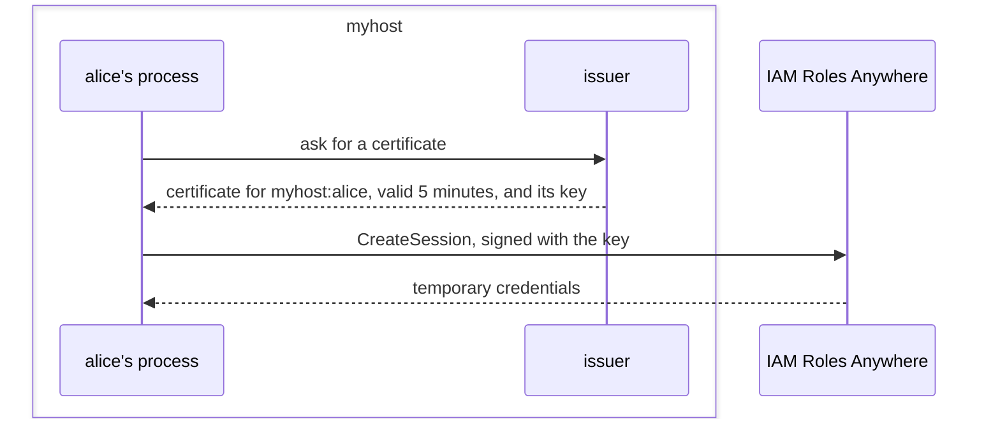
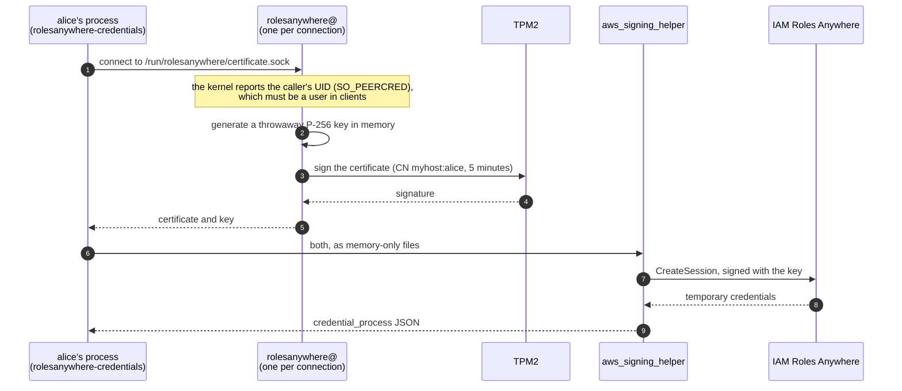

# rolesanywhere

Short-lived AWS credentials for the users of a NixOS machine, with no
long-lived keys on it. The machine runs its own certificate authority, whose
key never leaves its TPM2, and AWS trusts that CA as an
[IAM Roles Anywhere](https://docs.aws.amazon.com/rolesanywhere/latest/userguide/introduction.html)
trust anchor.



## At a glance

- **You get:** `aws sts get-caller-identity --profile myhost` working for `alice` on `myhost`.
- **Credential:** a 5-minute certificate for `myhost:alice` and its throwaway key.
- **Trust:** an AWS trust anchor holds the CA certificate; AWS never contacts the machine.
- **CA key:** ECDSA P-256 in the TPM2, signing only under the machine's Secure Boot state (PCR 7).
- **New CA:** registered by hand, after a Secure Boot key or dbx update or a TPM2 clear.
- **Requirements:** NixOS 26.05 or later, TPM 2.0 with Secure Boot, an AWS account, OpenTofu or Terraform.
- **Setup:** add the module → deploy → copy the CA certificate → apply `terraform/aws` → deploy → add an AWS profile.

## Setup

The examples use a machine named `myhost` and a user `alice`.

### 1. Add the flake

```nix
{
  inputs.rolesanywhere = {
    url = "github:gshpychka/rolesanywhere";
    inputs.nixpkgs.follows = "nixpkgs";
  };
}
```

and add `inputs.rolesanywhere.nixosModules.default` to the machine's modules.

### 2. Enable it

```nix
{
  services.rolesanywhere = {
    enable = true;
    clients = [ "alice" ];
  };
}
```

Deploy. The machine generates its CA in the TPM2, and
`journalctl -u rolesanywhere-ca` says it is not registered with AWS yet.

### 3. Register the CA

Copy the CA certificate from the machine into your configuration:

```sh
ssh myhost cat /var/lib/rolesanywhere/current/ca.pem > rolesanywhere-ca.pem
```

```nix
{
  services.rolesanywhere.caCertificate = ./rolesanywhere-ca.pem;
}
```

### 4. AWS

Describe the roles in `terraform/aws/roles.auto.tfvars`, one exact subject per
role:

```hcl
name = "myhost"
roles = {
  "myhost-alice" = {
    subject     = "myhost:alice"
    policy_arns = ["arn:aws:iam::aws:policy/ReadOnlyAccess"]
  }
}
```

```sh
cd terraform/aws
tofu init
tofu apply \
  -var aws_account_id=<12-digit account ID> \
  -var "ca_certificate=$(cat <path>/rolesanywhere-ca.pem)"   # with your usual AWS credentials
```

Deploy the machine again. `journalctl -u rolesanywhere-ca` now says the CA is
the one registered with AWS. A role without `policy_arns` can still run
`aws sts get-caller-identity`, which proves the whole chain.

### 5. Use it

As `alice`, in `~/.aws/config`, with the ARNs from `terraform/aws`'s outputs:

```ini
[profile myhost]
region = us-east-1
credential_process = rolesanywhere-credentials --trust-anchor-arn <trust_anchor_arn> --profile-arn <profile_arn> --role-arn <role ARN>
```

```sh
aws sts get-caller-identity --profile myhost
```

AWS CLIs and SDKs get fresh credentials from the profile on their own.
`rolesanywhere-credentials --certificate` prints a fresh certificate, without
its key. `alice`'s membership of the client group applies from their next login
after the deploy that adds her.

## How it works



- **Identity:** the caller sends nothing. The socket admits only the
  `rolesanywhere-clients` group (the users in `clients`), and the issuer
  checks the list again against the UID the kernel reports for the
  connection.
- **Issuer:** systemd starts one sandboxed `rolesanywhere@` instance per
  connection, without network access, with the current CA's files. It checks
  each certificate against the CA before replying, and refuses until the CA
  is the one `caCertificate` names.
- **CA key:** generated by the TPM2 with `fixedtpm|fixedparent|sensitivedataorigin`,
  so it cannot leave that TPM2. It has no auth value: its policy requires
  PCR 7, which records the Secure Boot state and keys, to hold the value it
  had when the key was created, and the TPM2 checks that on every signature.
  On disk is only the key wrapped by the TPM2's storage key.
- **Client:** `rolesanywhere-credentials` hands the certificate and key to
  `aws_signing_helper credential-process` as memfds, so the key is written to
  no file.
- **Audit:** Roles Anywhere names each session after its certificate's serial
  number, and the issuer's journal logs the same 40 hex digits with the
  user and process it issued to.

### The CA

`rolesanywhere-ca` runs at boot and on deploy. It keeps one CA, in
`/var/lib/rolesanywhere/<subject key ID>/` with `current` pointing at it:

- It generates a CA when there is none, when the TPM2 no longer signs with the
  current one (PCR 7 changed, or the TPM2 was cleared), or on
  `sudo rolesanywhere-replace-ca`.
- Each run loads the CA key, checks its attributes, and signs a probe with it.
- Each run logs whether the CA is the one registered with AWS. A new CA is
  registered the same way as the first: steps 3 and 4.

## Trust model

- **Identity is per Unix user.** Every process running as a client user can
  get that user's certificate.
- **Root on the issuing machine can issue a certificate for any of its
  subjects**, and so can anything that grants root: sudo rules, SSH agent
  forwarding, Nix `trusted-users`. The CA key never leaves the TPM2, so
  issuing ends with access to the machine.
- **AWS trusts one CA certificate**, the one in the trust anchor. Changing it
  takes AWS credentials that can update the trust anchor.
- **Each role trusts one exact subject** from one trust anchor: its trust
  policy matches `aws:SourceArn` and `aws:PrincipalTag/x509Subject/CN`.
- **Certificates live 5 minutes** (`certificateLifetime`), and a certificate
  without its key opens no session.

## Layout

| Path             | What it is                                                                                      |
| ---------------- | ----------------------------------------------------------------------------------------------- |
| `package/`       | `rolesanywhere` (the CA and the issuer) and `rolesanywhere-credentials` (the client), in Python |
| `module.nix`     | the NixOS module, `services.rolesanywhere`                                                      |
| `terraform/aws/` | the trust anchor, the profile, and the roles that trust its certificates                        |
| `tests/vm.nix`   | a NixOS VM test on an emulated TPM2                                                             |
